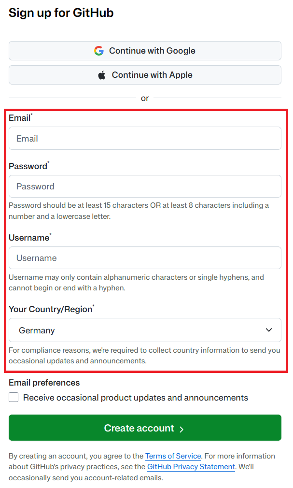
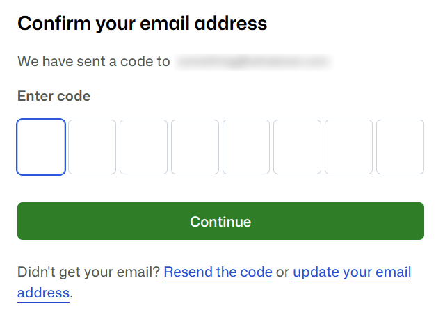
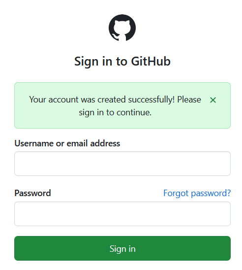
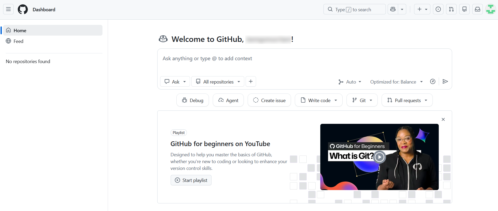

# Exercise 0 - Create a GitHub account

To complete the exercises in this hands-on workshop, you need a GitHub account.

> **Already have a GitHub account?** Make sure you can sign in to it, then skip this exercise and go straight to [Exercise 1](../ex1/README.md).

## Exercise steps

### Step 1 - Open the sign-up page

1. Open [https://github.com](https://github.com) in your browser.
2. Click **Sign up** in the top right corner.

   

### Step 2 - Enter your account details

1. Fill in the sign-up form:
   - **Email**: The email address you want to use for the account. Use an address you have access to right now, because GitHub sends a verification code to it.
   - **Password**: A strong password. GitHub shows the password requirements below the field.
   - **Username**: Your public GitHub username. It will be part of your repository URLs (`https://github.com/<username>/<repository>`), so pick something you are happy to keep.
   - **Your Country/Region**: Select your country or region.

   

2. Click **Create account**.

> **Note:** The GitHub account belongs to you, so you can keep using it after the hands-on workshop.

### Step 3 - Verify that you are human if prompted

GitHub may ask you to solve a visual puzzle to prove you are a human. If this happens, follow the instructions on the screen.

### Step 4 - Verify your email address

1. Check your inbox for an email from GitHub with a launch code. If you can't find it, check your spam folder.
2. Enter the code on the GitHub page.

   

### Step 5 - Sign in

1. When your email address has been verified, GitHub asks you to sign in. Sign in with your username (or email address) and password.

   

2. If GitHub asks you some personalization questions, you can answer them or skip them. They are not important for this hands-on workshop.

You are now on your GitHub dashboard.

> **Note:** GitHub may ask you to set up two-factor authentication (2FA) for your account. You don't need it for this hands-on workshop, but you can enable it at any time under **Settings** > **Password and authentication**.

## Summary

You now have a GitHub account and are signed in to it. Make a note of your username - you will need it in the following exercises.

Continue to [Exercise 1](../ex1/README.md).
