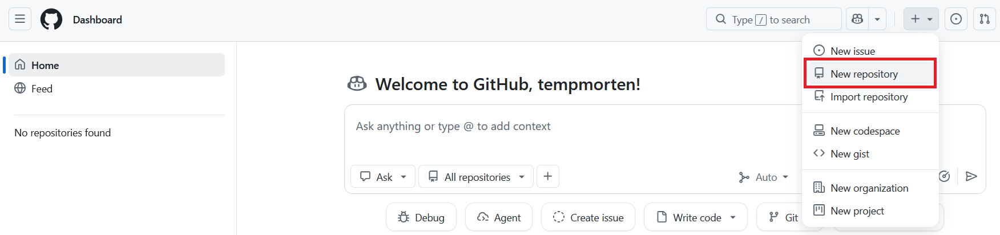
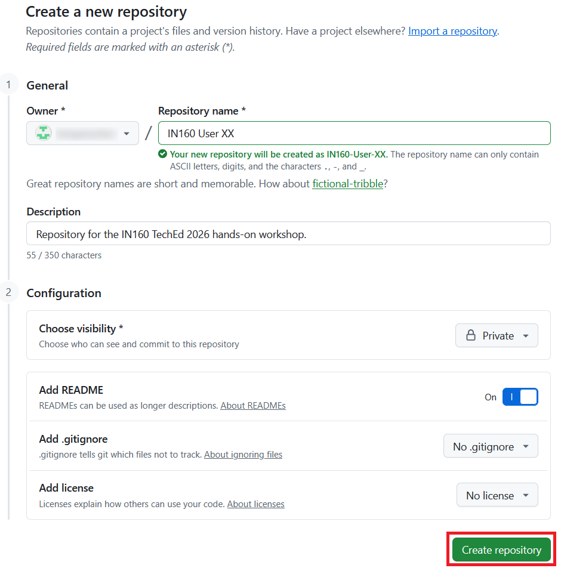
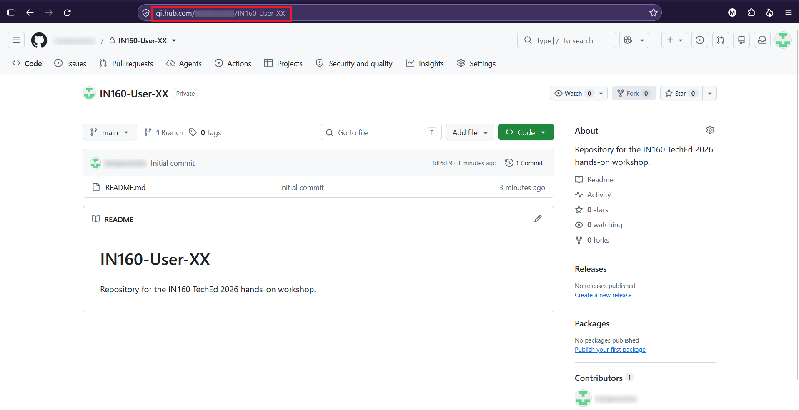
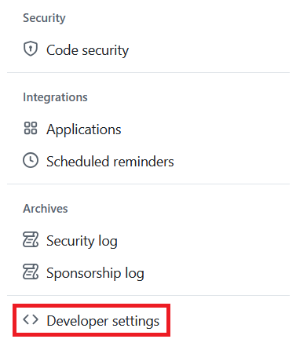
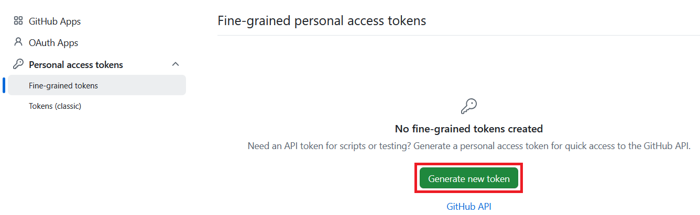
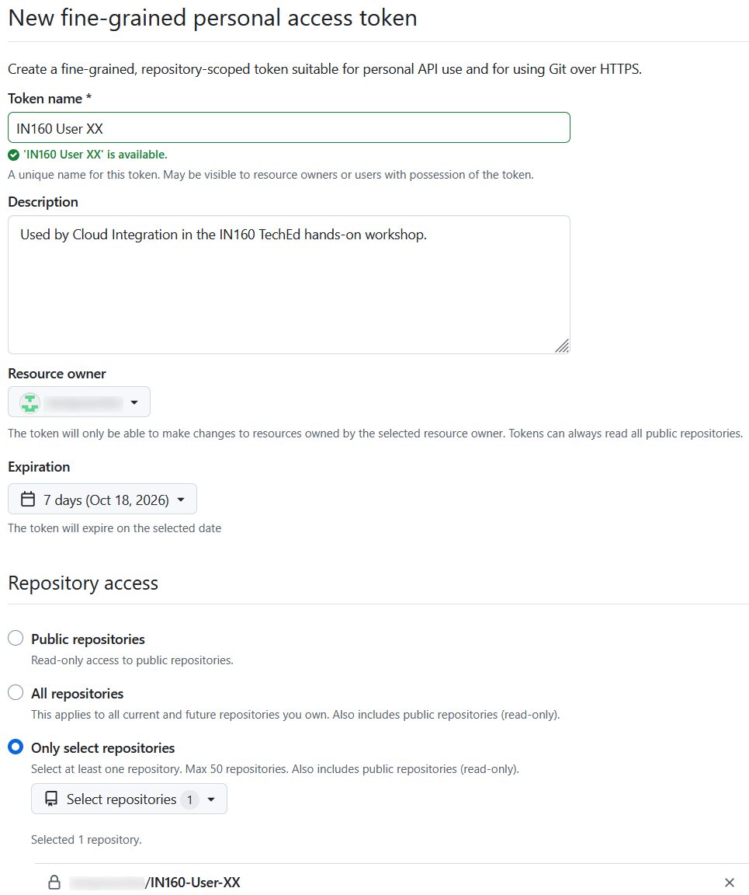
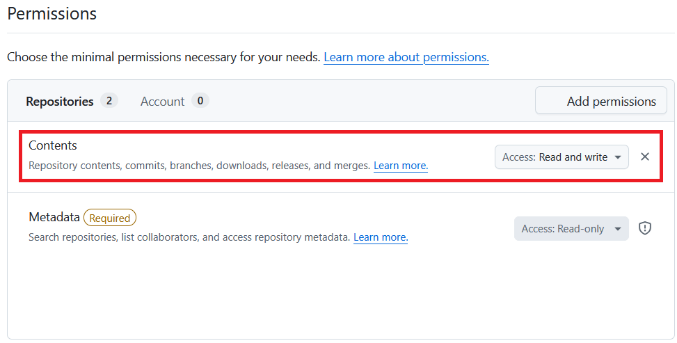
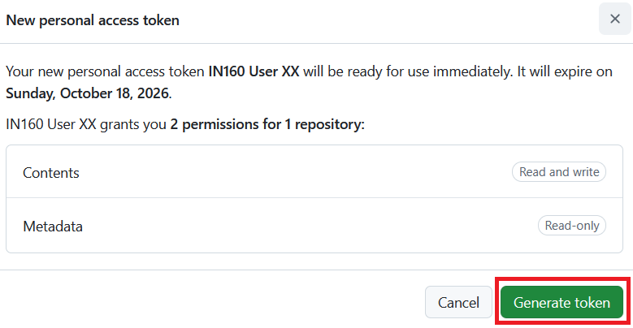
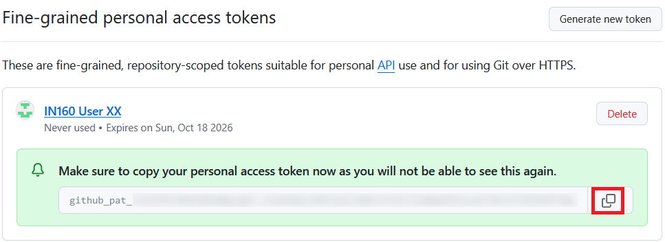

# Exercise 1 - Create a GitHub repository and a personal access token

In this exercise, you create the GitHub repository that will hold your integration flows. You then create a personal access token (PAT), which SAP Cloud Integration uses to access the repository on your behalf.

You will need both the repository URL and the PAT in the following exercises, so you will keep them in Notepad.

> [!IMPORTANT]
> Your instructor has given you a number. Throughout the exercises, whenever you see `XX`, replace it with your number. For example, if your number is 07, `IN160 User XX` becomes `IN160 User 07`.

## Exercise steps

### Step 1 - Open Notepad

Open the **Start** menu of your laptop, type `Notepad`, and open the **Notepad** app.

Keep Notepad open for the rest of the hands-on workshop.

> [!NOTE]
> You will copy the PAT to Notepad later. This token should be treated like a password, so don't save the Notepad file on the conference laptop.

### Step 2 - Start creating a new repository

1. Go to [https://github.com](https://github.com) and make sure you are signed in.
2. Click the **+** icon in the top right corner and choose **New repository**.

   

### Step 3 - Create the repository

1. Fill in the form:
   - **Repository name**: `IN160 User XX`, with `XX` replaced by your number, for example `IN160 User 07`. GitHub replaces the spaces with hyphens, so your repository will be called `IN160-User-XX`.
   - **Description**: `Repository for the IN160 TechEd 2026 hands-on workshop`. The description will be shown in SAP Cloud Integration later.
   - **Visibility**: **Private**
   - **Add README**: **On**. This creates the repository with a `main` branch, which you need in the following exercises.

   

2. Click **Create repository**.

### Step 4 - Copy the repository URL

Your new repository opens.

1. Copy the URL from the address bar of your browser. It looks like this: `https://github.com/<username>/IN160-User-XX`

   

2. Paste the URL into Notepad, like this:

   ```text
   Repository URL: https://github.com/<username>/IN160-User-XX
   ```

### Step 5 - Open the developer settings

1. Click your profile picture in the top right corner and choose **Settings**.
2. Scroll to the bottom of the menu on the left and click **Developer settings**.

   

### Step 6 - Start creating a fine-grained token

1. In the menu on the left, expand **Personal access tokens** and click **Fine-grained tokens**.
2. Click **Generate new token**.

   

If GitHub asks you to confirm your password or to authenticate in another way, do so.

### Step 7 - Enter the token details

1. Fill in the form:
   - **Token name**: `IN160 User XX`
   - **Description**: `Used by SAP Cloud Integration in the IN160 TechEd hands-on workshop`
   - **Resource owner**: Your GitHub username
   - **Expiration**: **7 days**. The token only needs to last for the hands-on workshop.
   - **Repository access**: **Only select repositories**. Then select your `IN160-User-XX` repository from the list.

   

### Step 8 - Give the token access to the repository contents

1. Under **Permissions**, click **Add permissions** next to **Repositories** and select **Contents**.
2. Next to **Contents**, change the access from **Read-only** to **Read and write**.

   

> [!NOTE]
> GitHub automatically adds the **Metadata** permission with read-only access. This is mandatory, so leave it as it is.

### Step 9 - Generate the token

1. Scroll to the bottom of the page and click **Generate token**.
2. GitHub shows a summary of the token. Check that it has access to your `IN160-User-XX` repository only, and that **Contents** has **Read and write** access. Then click **Generate token**.

   

### Step 10 - Copy the token to Notepad

GitHub now shows your new token.

> [!IMPORTANT]
> This is the only time GitHub shows the token. Copy it now. If you lose it, you have to regenerate it.

1. Click the copy icon next to the token.

   

2. Paste the token into Notepad below the repository URL, like this:

   ```text
   Repository URL: https://github.com/<username>/IN160-User-XX
   PAT: github_pat_...
   ```

> [!NOTE]
> Treat the token like a password. Anyone who has it can change the contents of your repository.

## Summary

You have created a private GitHub repository with a `main` branch, and a fine-grained personal access token that can read and write the contents of that repository only. The repository URL and the token are in Notepad, ready for the following exercises.

Continue to [Exercise 2](../ex2/README.md).
