# Exercise 2 - Connect your repository and create an integration flow

In this exercise, you log on to the SAP Integration Suite tenant and connect it to the GitHub repository you created in [Exercise 1](../ex1/README.md). You then create an integration package and a simple integration flow, which you will push to GitHub in the next exercise.

You will need the repository URL and the PAT you stored in Notepad in the previous exercise.

## Exercise steps

### Step 1 - Log on to the tenant

1. Open the tenant URL listed in the [README](../../README.md) of this repository.
2. Log on with the user and password your instructor gave you.

The SAP Integration Suite landing page opens.

### Step 2 - Open the Git access settings

1. In the menu on the left, choose **Settings** > **Integrations**.
2. Open the **Git Access** tab.
3. Click **Edit**.

   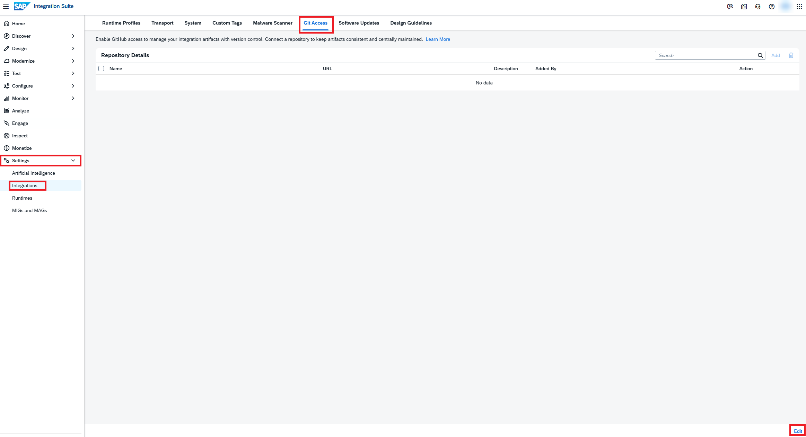

>[!TIP]
>The **Edit** button is located bottom right.

### Step 3 - Add your repository

1. In the **Repository Details** table, click **Add**.

>[!TIP]
>If the **Add** button is disabled, you are not in edit mode yet; click **Edit** first.

2. In the dialog, fill in the following fields with the values from Notepad:
   - **Repository URL**: The URL of your repository, `https://github.com/<username>/IN160-User-XX`
   - **Personal Access Token**: Your PAT
3. Click **Connect**. SAP Cloud Integration connects to your repository and fills in the **Name** and **Description** fields. The description is the one you entered when you created the repository.

   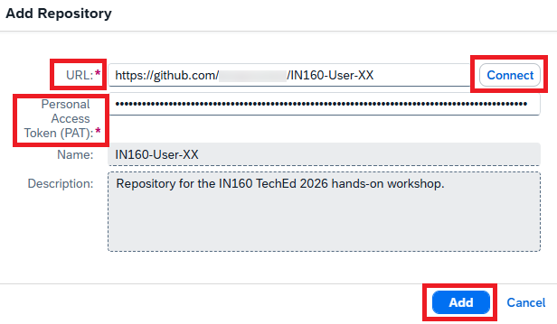

4. Click **Add**.

> **Note:** If the connection fails, check that the repository URL is correct and that you copied the whole PAT. Also check that the PAT has access to your repository and **Read and write** access to **Contents**.

### Step 4 - Save the settings

Your repository is now listed in the **Repository Details** table. Click **Save**.

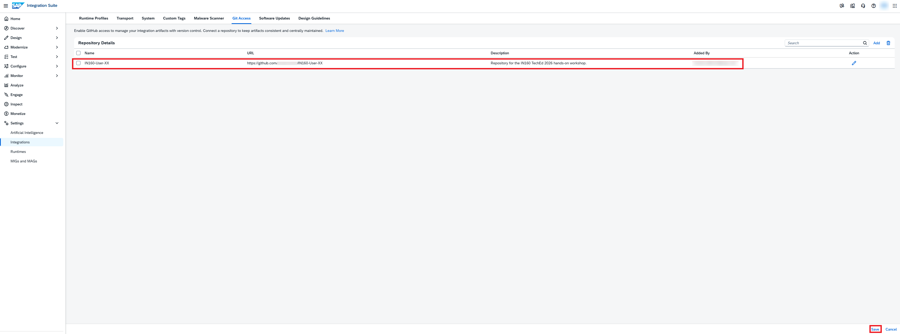

> **Note:** The tenant is shared with other participants, so you will see their repositories in the table as well. Only work with your own repository, `IN160-User-XX`.

### Step 5 - Start creating an integration package

1. In the menu on the left, choose **Design** > **Integrations and APIs**.
2. Click **Create**.

   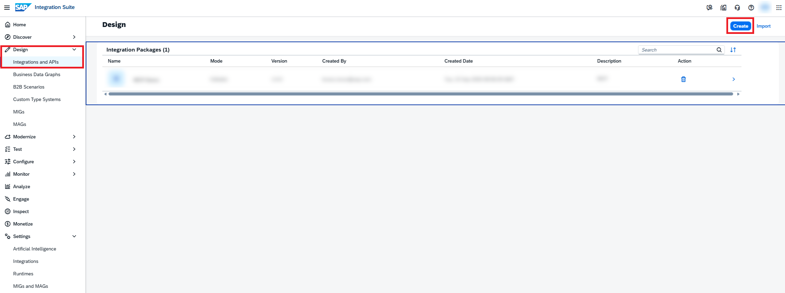

### Step 6 - Create the integration package

1. Fill in the package details:
   - **Name**: `IN160 User XX`
   - **Short Description**: `Package for the IN160 hands-on workshop`

   The **Technical Name** is filled in automatically.

   > **Important:** Other participants work on the same tenant, so make sure you use your own number instead of `XX`.

   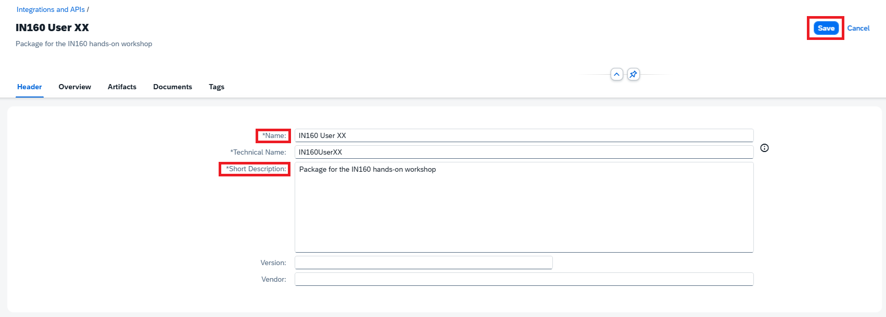

2. Click **Save**.

### Step 7 - Add an integration flow to the package

The package is still in edit mode after you saved it. This is okay, since you can only add integration flows to a package in edit mode.

1. Go to the **Artifacts** tab.
2. Click **Add** and choose **Integration Flow**.

   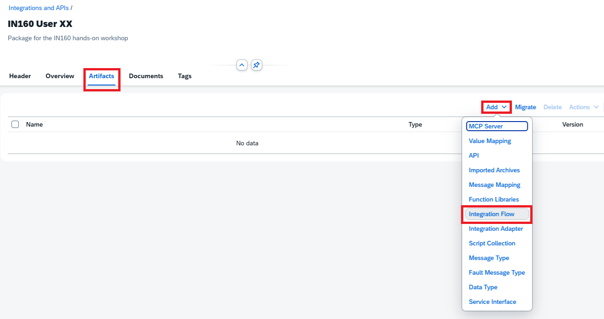

### Step 8 - Create the integration flow

1. In the **Add Integration Flow** dialog, click **Add Integrations manually**.
2. In the **Name** field, enter `IN160 User XX`. Use your own number here too. The **ID** is filled in automatically.

   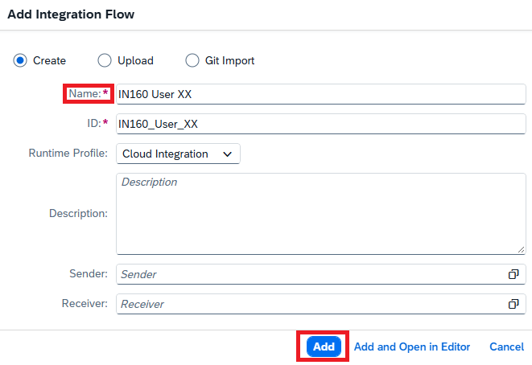

3. Click **Add**.
4. Click **Save**, then **Cancel** to leave edit mode of the package.
5. Click the `IN160 User XX` integration flow to open it.

The integration flow opens in the editor. It contains a sender, a receiver, and an integration process with a start event and an end event.

### Step 9 - Add a Groovy script step

1. Click **Edit** in the top right corner.
2. In the palette, choose **Message Transformers** > **Script** > **Groovy Script**.
3. Click the arrow between the start event and the end event to add the Groovy script step there.

   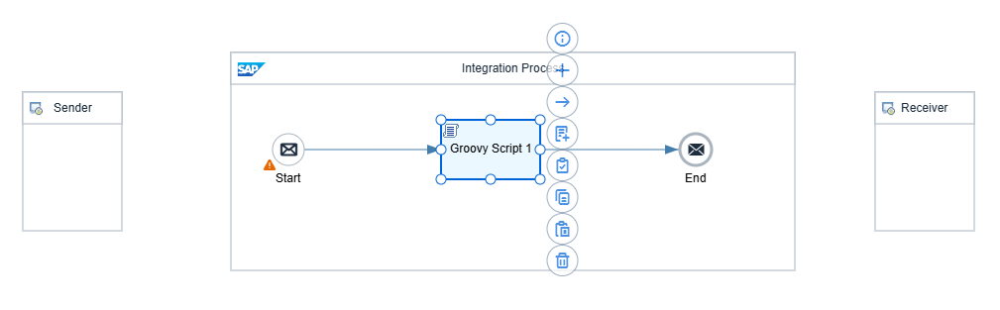

### Step 10 - Name the step

1. Select the new Groovy script step.
2. In the property sheet below the integration flow, open the **General** tab and change the **Name** to `Set payload`.

   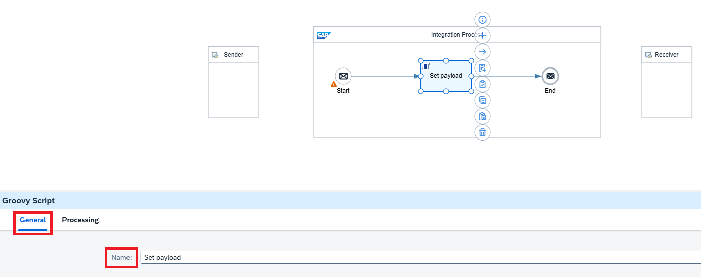

### Step 11 - Create the script

Select the **Set payload** step and click the **Create** (**+**) icon next to it.

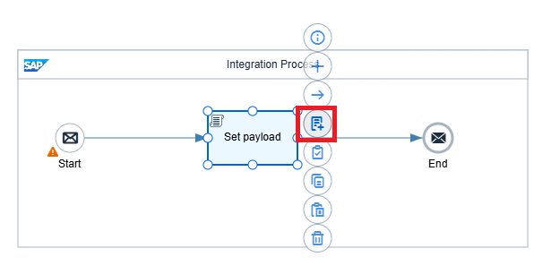

The script editor opens with a template script.

### Step 12 - Replace the template script

1. Open [payload-script.groovy](payload-script.groovy) in a new browser tab and copy its contents.
2. Go back to the script editor, delete the template script, and paste the contents of `payload-script.groovy`.

   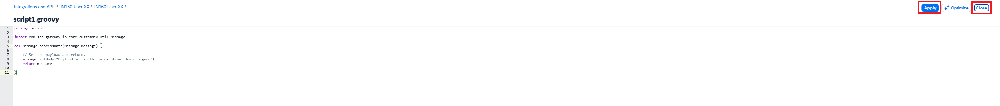

3. Click **Apply** then **Close** to close the script editor.

The script sets the message body to a fixed text. You don't need to understand the details for this hands-on workshop.

### Step 13 - Save the integration flow

1. Click **Save**.
2. Click **Cancel** to leave edit mode.

   

## Summary

You have connected your GitHub repository to the SAP Integration Suite tenant. You have also created the `IN160 User XX` integration package with the `IN160 User XX` integration flow, which contains a single Groovy script step. The integration flow only exists on the tenant so far. In the next exercise, you push it to your repository.

Continue to [Exercise 3](../ex3/README.md).
