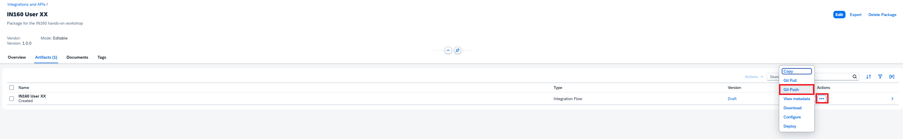
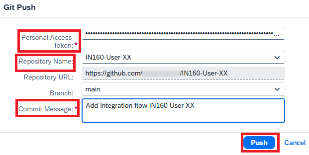
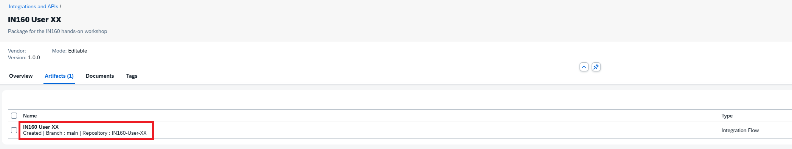
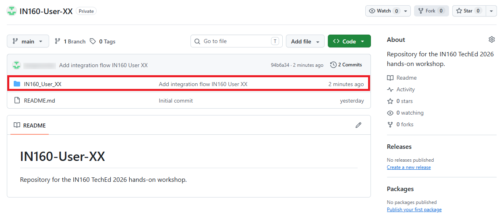
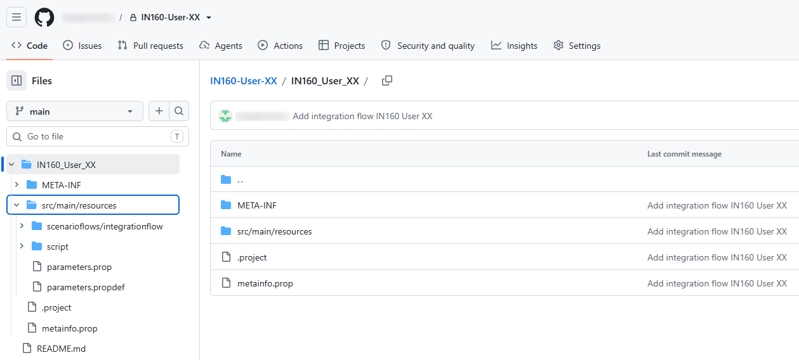
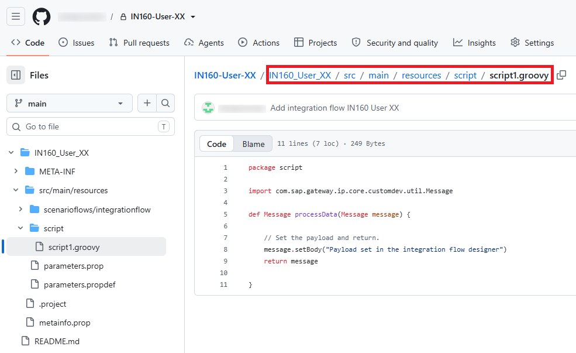
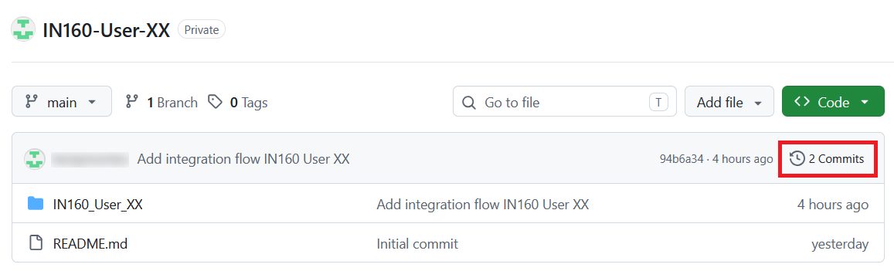
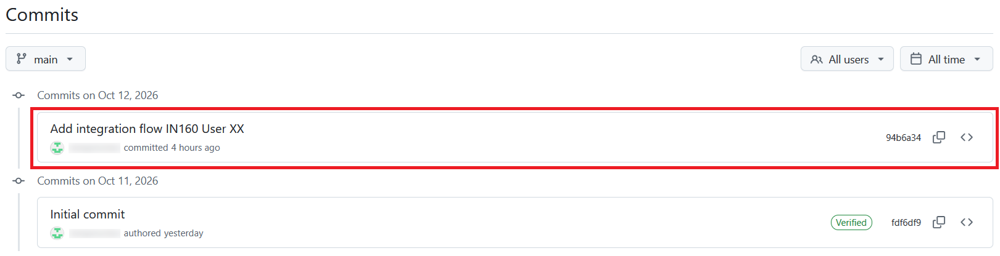

# Exercise 3 - Push your integration flow to GitHub

In this exercise, you push the integration flow you created in [Exercise 2](../ex2/README.md) to your GitHub repository. You then explore how the integration flow is stored in the repository, and find the commit that SAP Cloud Integration created.

You will need the PAT you stored in Notepad earlier.

## Exercise steps

### Step 1 - Open your integration package

1. In SAP Integration Suite, choose **Design** > **Integrations and APIs** in the menu on the left.
2. Click your `IN160 User XX` package.
3. Open the **Artifacts** tab.

### Step 2 - Start the Git push

In the row of the `IN160 User XX` integration flow, click the **Actions** (**...**) icon and choose **Git Push**.

### Step 3 - Push the integration flow

1. Fill in the push details:
   - **Personal Access Token**: Your PAT from Notepad
   - **Repository**: Choose your `IN160-User-XX` repository from the dropdown list
   - **Branch**: `main`
   - **Commit Message**: `Add integration flow IN160 User XX`

   

2. Click **Push**.

> [!TIP]
> Write commit messages that describe what you changed and why. They are what you and your colleagues see in the history of the repository.

### Step 4 - Check the Git information of the integration flow

The **Artifacts** tab now shows the repository and branch of the integration flow.

### Step 5 - Find the integration flow in GitHub

1. Go back to your repository in GitHub. You can use the repository URL from Notepad if you closed it in the meantime.
2. The repository now contains a new folder, `IN160_User_XX`, which is named after the ID of your integration flow.

   

### Step 6 - Explore the folder structure

Click the `IN160_User_XX` folder and explore its contents. The integration flow is stored as a set of files and folders.

### Step 7 - Find your script

1. Open the `src/main/resources/script/` folder.
2. Click `script1.groovy`. It contains the script you pasted into the **Set payload** step in Exercise 2.

   

Remember where the script is located. You will edit it in a later exercise.

### Step 8 - Open the commit history

1. Go back to the start page of your repository, for example by clicking the repository name at the top of the page.
2. The number of commits is now **2**. Click **2 Commits**.

   

### Step 9 - Find the commit from SAP Cloud Integration

The list of commits contains two commits:

- The **Initial commit**, which GitHub created together with the README file in Exercise 1.
- The commit from SAP Cloud Integration, with the commit message you entered in Step 3.

## Summary

You have pushed your integration flow from SAP Cloud Integration to your GitHub repository. The integration flow is stored in a folder named after its ID, and its script is located in `src/main/resources/script/`. The push created a new commit in the repository, with the commit message you entered in SAP Cloud Integration.

Continue to [Exercise 4](../ex4/README.md).
