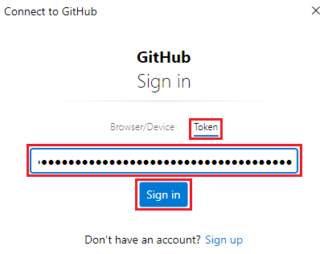
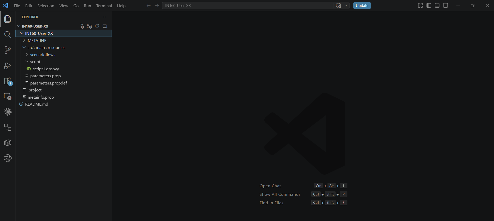
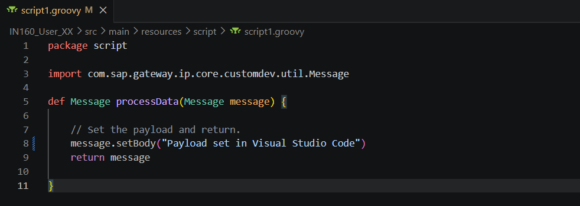
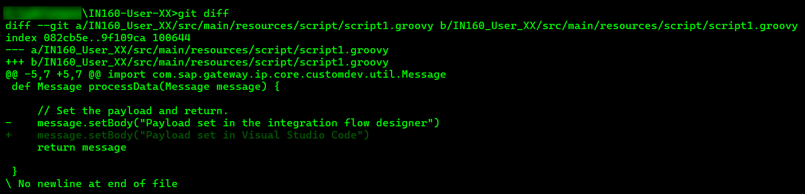
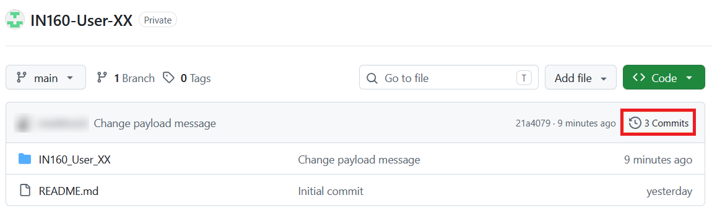
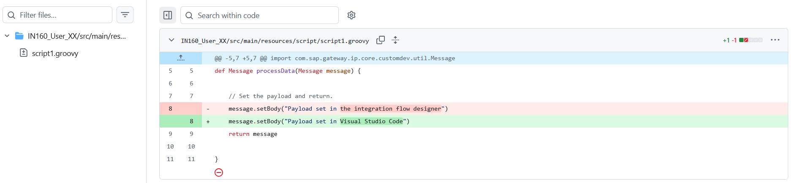
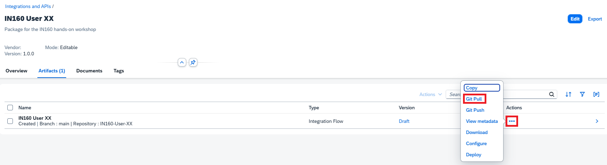
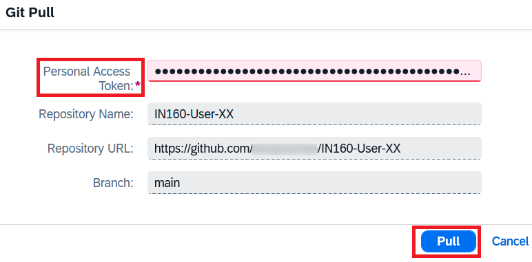
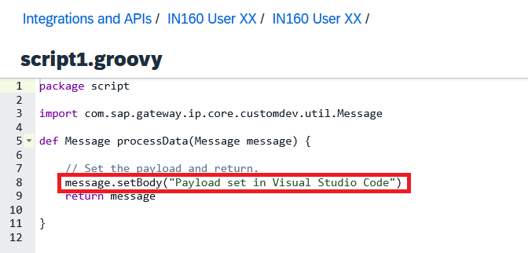

# Exercise 4 - Work with your integration flow locally

In this exercise, you clone your repository to your laptop and change the integration flow's Groovy script in Visual Studio Code. You commit the change, push it to GitHub, and then pull the updated integration flow into Cloud Integration.

This shows how developers can work on integration content with their usual tools, and how GitHub connects these tools with Cloud Integration.

You will need the repository URL and the PAT you stored in Notepad.

## Exercise steps

### Step 1 - Open Windows Terminal

Open the **Start** menu of your laptop, type `Terminal`, and open the **Terminal** app.

Windows Terminal opens in your user folder. You will clone your repository into this folder.

### Step 2 - Clone your repository

Cloning a repository creates a local copy of it, including its complete history.

Run the following command. Replace `<username>` with your GitHub username and `XX` with your number, or copy the repository URL from Notepad.

```shell
git clone https://github.com/<username>/IN160-User-XX
```

### Step 3 - Sign in to GitHub

Your repository is private, so Git needs to authenticate with GitHub. The Git Credential Manager opens a sign-in window.

1. Open the **Token** tab.
2. Paste your PAT from Notepad.
3. Click **Sign in**.

   

Git now clones the repository into a new folder, `IN160-User-XX`.

> [!NOTE]
> The Git Credential Manager stores your PAT on the laptop, so you don't have to sign in again for the rest of this exercise.

### Step 4 - Go to the repository folder and tell Git who you are

1. Go to the new folder. You will run all the following commands in this exercise from there.

   ```shell
   cd IN160-User-XX
   ```

2. Git records the name and email address of the author of every commit. Set your name and email address for this repository. Use the email address of your GitHub account.

   ```shell
   git config user.name "<your name>"
   git config user.email "<your email address>"
   ```

### Step 5 - Open the repository in Visual Studio Code

1. Run the following command to open the current folder in Visual Studio Code:

   ```shell
   code .
   ```

2. If Visual Studio Code asks whether you trust the authors of the files in this folder, click **Yes, I trust the authors**.

   

### Step 6 - Change the script

1. In the **Explorer** on the left, open the `IN160_User_XX/src/main/resources/script` folder and click `script1.groovy`.
2. Change the text in the `setBody` call from `Payload set in the integration flow designer` to `Payload set in Visual Studio Code`:

   ```groovy
   message.setBody("Payload set in Visual Studio Code")
   ```

3. Press **Ctrl+S** to save the file.

   

### Step 7 - See what you have changed

Go back to Windows Terminal and run the following command:

```shell
git diff
```

Git shows the differences between your local files and the last commit. Removed lines start with `-`, and added lines start with `+`.



> [!TIP]
> If the output ends with a `:` or `(END)`, press **Q** to return to the command line.

### Step 8 - Commit your change

A commit stores your change in the local repository. Run the following commands:

```shell
git add .
git commit -m "Change payload message"
```

`git add` selects the changed files for the next commit, and `git commit` creates the commit with your commit message.

### Step 9 - Push your change to GitHub

So far, the commit only exists on your laptop. Run the following command to push it to your repository on GitHub:

```shell
git push
```

### Step 10 - Check the commit in GitHub

1. Go to your repository in GitHub and refresh the page.
2. The number of commits is now **3**. Click **3 Commits**.

   

### Step 11 - See the change in GitHub

In the list of commits, click your new commit, **Change payload message**.

GitHub shows the change to the script, just like `git diff` did on your laptop.



### Step 12 - Start the Git pull in Cloud Integration

Your integration flow in Cloud Integration still contains the old script. You now pull the change from GitHub.

1. In SAP Integration Suite, choose **Design** > **Integrations and APIs** in the menu on the left.
2. Click your `IN160 User XX` package and open the **Artifacts** tab.
3. In the row of the `IN160 User XX` integration flow, click the **Actions** (**...**) icon and choose **Git Pull**.



### Step 13 - Pull the integration flow

1. Check that the dialog shows your integration flow, your `IN160-User-XX` repository, and the `main` branch.
2. Enter your PAT from Notepad.

   

3. Click **Pull**.

### Step 14 - Check the script in Cloud Integration

1. Click the `IN160 User XX` integration flow to open it.
2. Select the **Set payload** step and open its script from the **Processing** tab.

   

The script now sets the payload to `Payload set in Visual Studio Code`.

## Summary

You have cloned your repository to your laptop, changed the script in Visual Studio Code, and used `git diff` to see your change. You then committed the change, pushed it to GitHub, and pulled the updated integration flow into Cloud Integration. GitHub now connects your local development tools with Cloud Integration.

Continue to [Exercise 5](../ex5/README.md).
