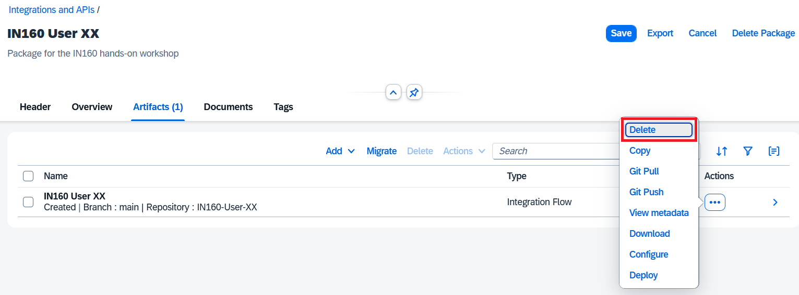
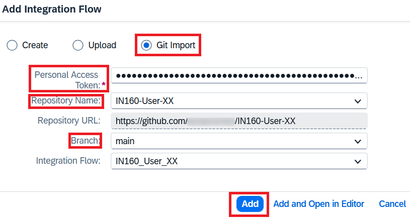
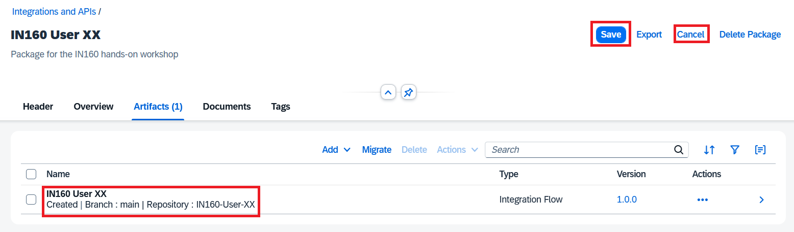
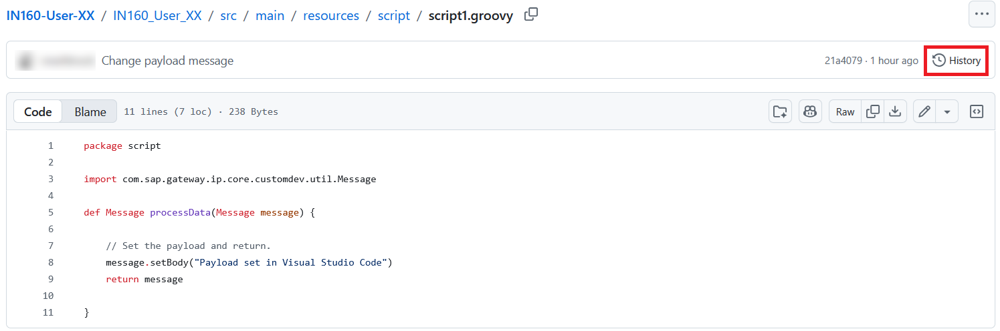
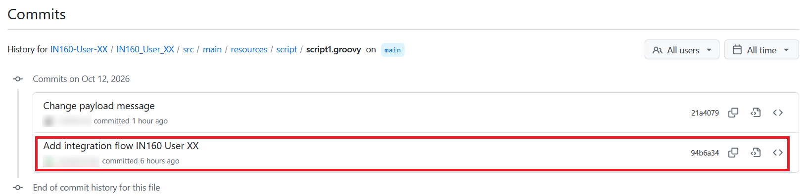

# Exercise 5 - Restore your integration flow from GitHub

In this exercise, you delete your integration flow from the tenant, as if someone had deleted it by accident. You then restore it from your GitHub repository with Git Import.

This shows one of the main benefits of the GitHub integration: your repository is a backup of your integration flows.

You will need the PAT you stored in Notepad.

## Exercise steps

### Step 1 - Delete the integration flow

1. In SAP Integration Suite, choose **Design** > **Integrations and APIs** in the menu on the left.
2. Click your `IN160 User XX` package and open the **Artifacts** tab.
3. Click **Edit** in the top right corner. You can only delete integration flows when the package is in edit mode.
4. In the row of the `IN160 User XX` integration flow, click the **Actions** (**...**) icon and choose **Delete**.

   

5. Confirm that you want to delete the integration flow.

The integration flow is now gone from the tenant. Deleting it on the tenant doesn't change your repository, so the integration flow is still in GitHub.

### Step 2 - Start adding an integration flow

The package is still in edit mode. In the **Artifacts** tab, click **Add** and choose **Integration Flow**, just like in Exercise 2.

### Step 3 - Import the integration flow from GitHub

1. In the dialog, click **Add Integrations manually**.
2. Then choose **Git Import**.
3. Fill in the details:
   - **Personal Access Token**: Your PAT from Notepad
   - **Repository**: Choose your `IN160-User-XX` repository from the drop-down list
   - **Branch**: Choose `main` from the drop-down list (it's the only option)
   - **Integration Flow**: `IN160_User_XX` is selected automatically (it's the only integration flow in the repository)

   

4. Click **Add**.

Git Import adds the latest version of the integration flow on the `main` branch to your package.

### Step 4 - Check the Git information of the integration flow

The integration flow is back in the **Artifacts** tab. It is linked to your repository and branch again, so you can push and pull it as before.

Click **Save**, then **Cancel** to leave edit mode of the package.

### Step 5 - Check the script

1. Click the `IN160 User XX` integration flow to open it.
2. Select the **Set payload** step and open its script from the **Processing** tab.

The script sets the payload to `Payload set in Visual Studio Code`. This is the version you pushed from your laptop in Exercise 4.

### Step 6 - Look at the history of the script

Git Import only brings the latest version back to the tenant. The earlier versions are still in your repository.

1. Go to your repository in GitHub and open `IN160_User_XX/src/main/resources/script/script1.groovy`.

   

2. Click **History**.

### Step 7 - Look at an earlier version of the script

The history shows the two commits that changed the script: the push from SAP Cloud Integration in Exercise 3, and your commit from Visual Studio Code in Exercise 4.

Click the older commit, **Add integration flow IN160 User XX**. GitHub shows what this commit added: all the files of the integration flow. Scroll down to `script1.groovy` to see the original script with the text `Payload set in the integration flow designer`.

## Summary

You have deleted your integration flow from the tenant and restored it from your GitHub repository with Git Import. The restored integration flow is the latest version from the `main` branch, and it is linked to your repository again. The earlier versions of the integration flow are still available in the history of your repository.

Continue to [Exercise 6](../ex6/README.md).
