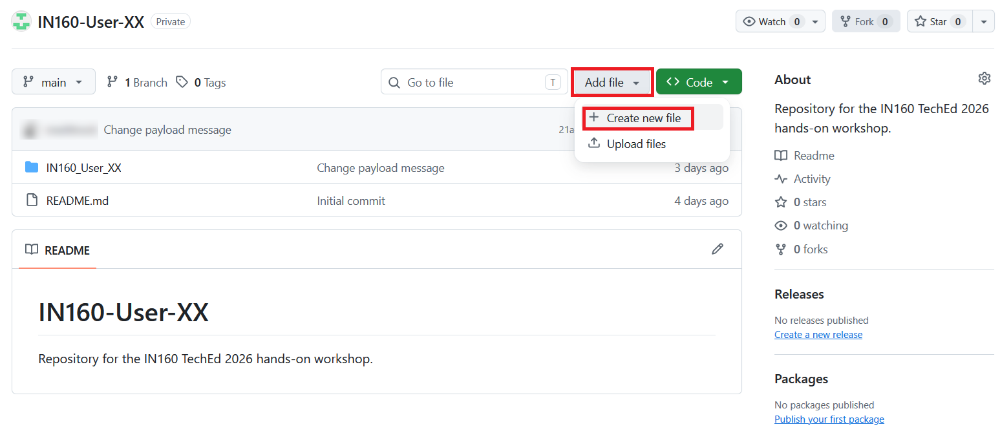
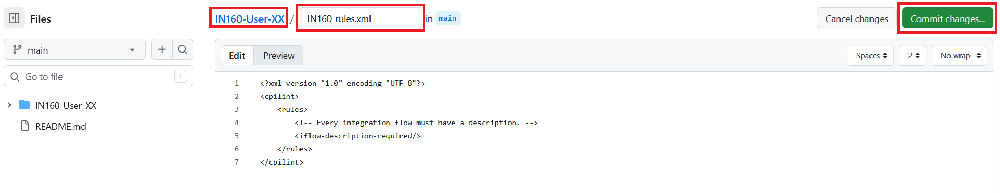
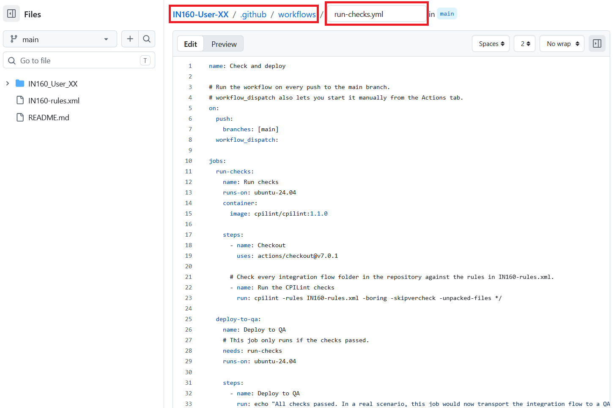
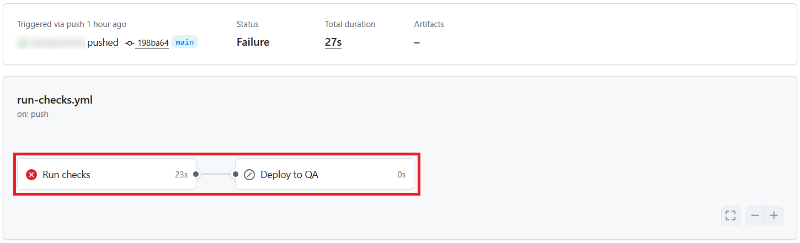
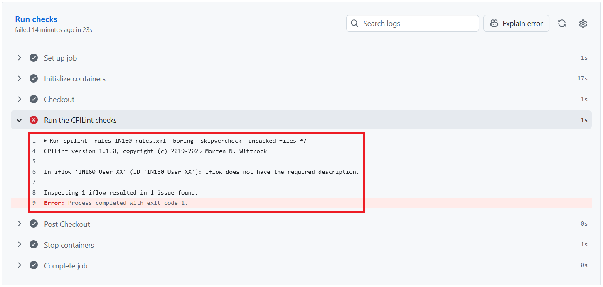
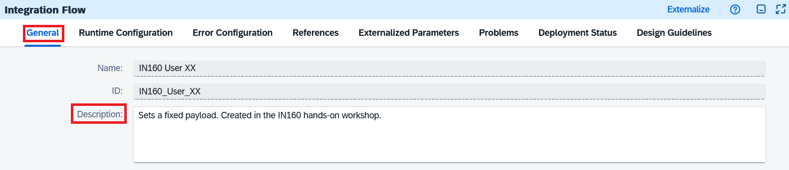
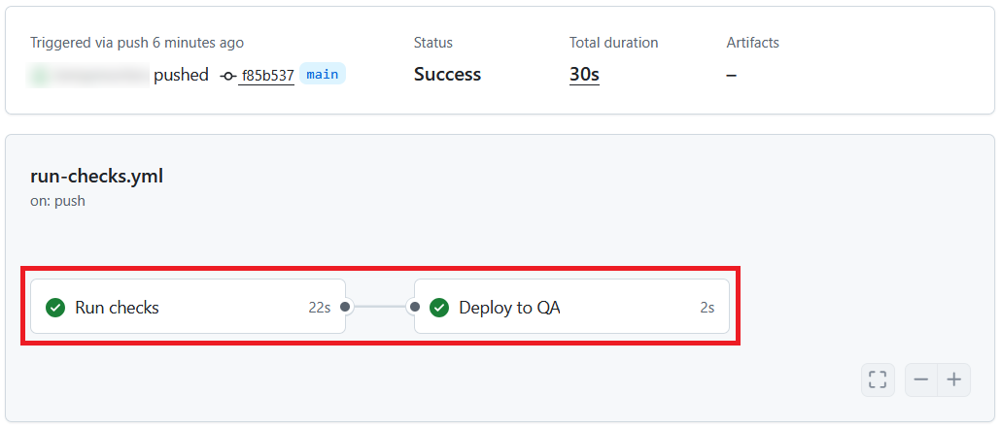
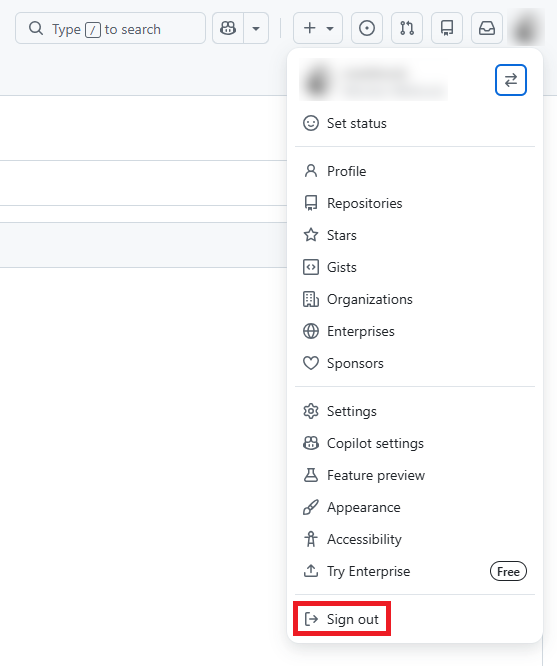

# Exercise 6 - Check your integration flow automatically with GitHub Actions

The final exercise introduces a more advanced topic: CI/CD (Continuous Integration/Continuous Delivery) pipelines. CI/CD pipelines are hosted by your Git platform and are often configured to start when a commit is pushed to your repository. The pipeline then executes a series of steps of your choosing. For regular code, these steps could be compiling the code, performing static analysis, executing tests and finally deploying the code to a QA system if all checks pass. The integration flow pipeline you will set up in this exercise follows the same pattern: a quality check takes the place of compilation and testing, and if it passes, the flow is deployed automatically.

GitHub Actions is GitHub's built-in CI/CD service. In this exercise, you will set up a pipeline for your integration flow. It will run every time something is pushed to your repository, for example when you push your integration flow from SAP Cloud Integration.

The pipeline checks your integration flow with [CPILint](https://github.com/mwittrock/cpilint), an open source tool that checks integration flows against a set of rules. In this exercise, there is a single rule: every integration flow must have a description. If the check fails, the pipeline stops. If it passes, the pipeline continues with a deployment job.

You will need the PAT you stored in Notepad.

## Exercise steps

### Step 1 - Start creating the rules file

The CPILint rules are stored in a file at the root level of your repository, next to the `IN160_User_XX` folder of your integration flow.

1. Open [IN160-rules.xml](cicd/IN160-rules.xml) in a new browser tab and copy its contents.
2. Go to the start page of your repository in GitHub, for example by clicking the repository name at the top of the page.
3. Click **Add file** and choose **Create new file**.

   

> [!IMPORTANT]
> Make sure you are on the start page of your repository, and not inside the `IN160_User_XX` folder. GitHub creates the new file in the folder you are looking at, and the CPILint command used below looks for the rules file at the root level of the repository.

### Step 2 - Create the rules file

1. In the file name field, enter `IN160-rules.xml`. The path in front of the field must only show your repository name, `IN160-User-XX`.
2. Paste the contents of `IN160-rules.xml` into the editor.

   

3. Click **Commit changes...**.
4. Keep the suggested commit message and click **Commit changes**.

The file contains a single rule, `iflow-description-required`. It requires every integration flow to have a description.

> [!NOTE]
> In a real scenario, the rules could be stored in a separate repository. The **Run checks** job would then fetch the rules from that repository before running CPILint.

### Step 3 - Create the workflow file

A GitHub Actions pipeline is called a workflow. Workflows are stored in the `.github/workflows` folder of the repository.

1. Open [run-checks.yml](cicd/run-checks.yml) in a new browser tab and copy its contents.
2. Go back to the start page of your repository in GitHub, click **Add file**, and choose **Create new file**. Like the rules file, the `.github` folder must be at the root level of the repository.
3. In the file name field, enter `.github/workflows/run-checks.yml`. Each time you type a `/`, GitHub turns the text before it into a folder.
4. Paste the contents of `run-checks.yml` into the editor.

   

5. Click **Commit changes...**.
6. Keep the suggested commit message and click **Commit changes**.

The workflow contains two jobs:

- **Run checks** runs CPILint with the rules in `IN160-rules.xml`. It checks every integration flow folder in your repository, so it checks your `IN160_User_XX` folder. CPILint is available as a Docker image on Docker Hub (`cpilint/cpilint`), so the job runs in a container from that image, and doesn't need to install anything first.
- **Deploy to QA** only runs if **Run checks** passed. Right now it only prints a message. In a real scenario, this job could transport the integration flow to a QA tenant for testing.

### Step 4 - Watch the workflow run

Committing the workflow file was also a push to your repository, so the workflow has already started.

1. Open the **Actions** tab of your repository.
2. Click the workflow run in the list. It is the only run so far.

   

The run has failed. **Run checks** failed, and **Deploy to QA** was skipped, because it only runs if the checks pass.

> [!NOTE]
> GitHub also sends you an email about the failed run. This way, you find out about failed checks even when you aren't looking at the **Actions** tab.

### Step 5 - Find out why the check failed

1. Click the **Run checks** job.
2. Expand the **Run the CPILint checks** step if it isn't expanded already.

   

CPILint reports that your integration flow does not have the required description. You will fix this in SAP Cloud Integration.

### Step 6 - Add a description to your integration flow

1. In SAP Integration Suite, choose **Design** > **Integrations and APIs** in the menu on the left.
2. Click your `IN160 User XX` package, open the **Artifacts** tab, and click the `IN160 User XX` integration flow to open it.
3. Click **Edit** in the top right corner.
4. Click an empty area of the canvas, outside the integration process, to show the properties of the integration flow.
5. On the **General** tab, in the **Description** field, enter `Sets a fixed payload. Created in the IN160 hands-on workshop.`

   

6. Click **Save**, then **Cancel** to leave edit mode.

### Step 7 - Push the integration flow

Push the changed integration flow to GitHub, just like in Exercise 3:

1. Go back to the **Artifacts** tab of your `IN160 User XX` package.
2. In the row of the `IN160 User XX` integration flow, click the **Actions** (**...**) icon and choose **Git Push**.
3. Enter your PAT from Notepad, check that the dialog shows your `IN160-User-XX` repository and the `main` branch, and enter the commit message `Add description`.
4. Click **Push**.

### Step 8 - Check the new workflow run

1. Go back to the **Actions** tab of your repository in GitHub. The push from SAP Cloud Integration has started a new workflow run, **Add description**, at the top of the list. It is named after the commit message you entered in Step 7.
2. Wait until the run has finished, which takes about half a minute, then click it. Both jobs have passed this time.

   

3. Click the **Deploy to QA** job and expand the **Deploy to QA** step to see its message.

### Step 9 - Delete your PAT and sign out of GitHub

> [!WARNING]
> Complete this step to make sure only you have access to your GitHub account and repository.

You used your PAT to connect to GitHub from the workshop laptop and from SAP Cloud Integration. To ensure that only you have access to your repository and your GitHub account, the final step of this exercise is to delete the token and log out of GitHub in the browser.

1. In GitHub, click your profile picture in the top right corner and choose **Settings**.
2. Click **Developer settings** at the bottom of the menu on the left, then **Personal access tokens** > **Fine-grained tokens**.
3. In the row of the `IN160 User XX` token, click **Delete** and confirm.
4. Click your profile picture in the top right corner again and choose **Sign out**.

   

Your repository and your GitHub account stay, so you can come back to them after the hands-on workshop.

## Summary

You have set up a CI/CD pipeline with GitHub Actions. Every push to your repository, including a Git Push from SAP Cloud Integration, now checks your integration flow with CPILint. The first run failed because your integration flow had no description. After you added the description and pushed again, the checks passed and the pipeline continued with the deployment job.

This was the last exercise. Thank you for taking part in the IN160 hands-on workshop!
